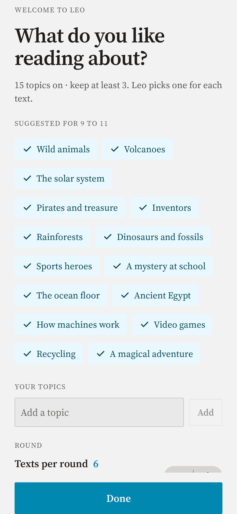
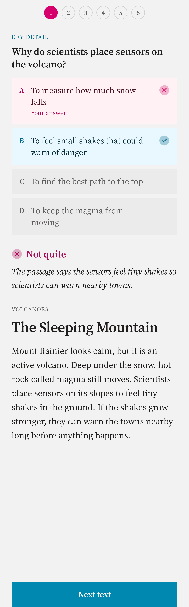
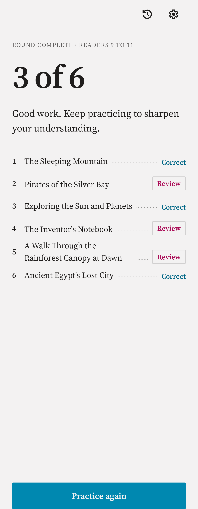
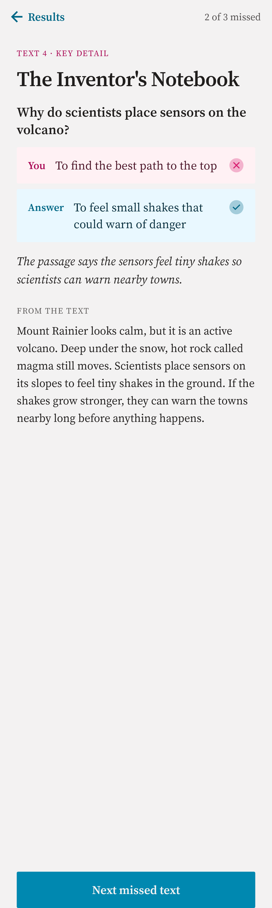

# Leo for Android

Leo helps people of all ages build their reading comprehension. Each round has six short texts by default (3 to 9, chosen during onboarding or in Settings), written for the reader's age on topics they like, each followed by a question. Everything is generated on the device by Google's Gemini Nano, through the [ML Kit Prompt API](https://developers.google.com/ml-kit/genai/prompt/android) and AICore, so Leo works offline and nothing the reader does leaves their phone or tablet.

This is the Android port of [Leo for iOS](https://github.com/3aVarana/Leo-App), which is the specification: behavior, copy, limits and prompts come from it, and each deliberate difference is written down in the port plan ([docs/Leo-Android-Port-Plan.md](docs/Leo-Android-Port-Plan.md)).

<table>
  <tr>
    <td><picture><source media="(prefers-color-scheme: dark)" srcset="app/src/test/snapshots/OnboardingSnapshotTests/topics-nine-dark-en.png"></picture></td>
    <td><picture><source media="(prefers-color-scheme: dark)" srcset="app/src/test/snapshots/ExerciseScreenSnapshotTests/wrong-dark-en.png"></picture></td>
    <td><picture><source media="(prefers-color-scheme: dark)" srcset="app/src/test/snapshots/ResultScreenSnapshotTests/3-of-6-dark-en.png"></picture></td>
    <td><picture><source media="(prefers-color-scheme: dark)" srcset="app/src/test/snapshots/ReviewScreenSnapshotTests/2-of-3-dark-en.png"></picture></td>
  </tr>
</table>

## Why Leo

The idea for Leo came from the PISA 2025 results, published by the OECD on September 8, 2026. They showed a historic drop in student performance around the world, and reading had the sharpest decline of all: across OECD countries, reading scores fell 28 points between 2015 and 2025. ([Education International](https://www.ei-ie.org/en/item/32952:new-pisa-report-reveals-decline-in-student-performance-amid-chronic-teacher-shortage-and-shrinking-attention-spans), [BBC News Mundo](https://www.bbc.com/mundo/articles/c8r6yl61v0ko), in Spanish)

Reading and understanding a text is the foundation for learning everything else. Leo is meant to make practicing that skill easy and engaging, at any age: short texts at the right level, on topics the reader cares about, with feedback that explains the answer.

## Features

- **Five age groups:** 6–8, 9–11, 12–14, 15–17 and 18+. The age group sets how long the passages are and how complex their language is, from 50–80 words of short, everyday sentences up to 160–230 words with varied structure and precise vocabulary, and younger readers get larger text.
- **Five comprehension skills:** a round of five or more texts mixes questions on the main idea, key details, inference, vocabulary in context and the author's purpose, so every skill appears. A shorter round of 3 or 4 texts gets a different skill for each text, so it doesn't cover all five.
- **Topics the reader chooses:** each age group has its own list of suggested topics that can be turned on and off, and readers can add their own. The on-device model checks that a new topic suits the reader's age and tidies up its wording before it's saved.
- **Texts per round:** the reader picks how many texts a round has, from 3 to 9 (six by default), on the topics screen of onboarding and in Settings. A change applies to the next round.
- **Read first, then answer:** each exercise shows only the title and the passage at first. The question and its answers appear when the reader taps "Answer the question" or the reading timer runs out. The timer gives each age group time to read at a relaxed pace, at least 30 seconds; it can be turned off in Settings and is always off while TalkBack is running.
- **Feedback that teaches:** after a wrong answer, Leo shows the correct one and a short explanation that points back to the passage. At the end of a round, Review goes back through the missed texts with the reader's answer, the right one, the explanation and the passage.
- **History:** every finished round is saved on the device, grouped by week and month, with its score and which texts were missed, so a reader can come back to it and review a text again. History follows the current age group, and a round can be swiped away.
- **Reads in your language:** texts are written in the device's language when Gemini Nano supports it, and in English otherwise. The interface is available in English, Spanish and Brazilian Portuguese, and on Android 13 and later each can be chosen for Leo alone in the system's app language settings.
- **Little waiting for questions:** the exercises start generating in the background as soon as the app opens, before the reader taps Start. A text that can't be written is replaced by another one automatically, up to 3 times per round.
- **Accessible:** TalkBack with headings, merged rows and action labels; font size up to 200%; dark theme; the system's contrast setting on Android 14 and later.
- **Phones and tablets,** in portrait and landscape.
- **Made to read like print:** the Broadsheet design sets everything in [Source Serif 4](https://github.com/adobe-fonts/source-serif) on a warm paper ground, with a dark ink version for the dark theme, and the app opens with a short intro where the Leo wordmark settles into place.

## How it uses Gemini Nano

Leo uses the on-device language model for two jobs: writing exercises and reviewing custom topics. The only code that talks to it is in [`data/genai/`](app/src/main/java/com/victorarana/leo/data/genai).

### Writing exercises

[`ExerciseGenerator`](app/src/main/java/com/victorarana/leo/data/genai/ExerciseGenerator.kt) asks the model for a [`GeneratedExercise`](app/src/main/java/com/victorarana/leo/data/genai/GeneratedExercise.kt): a passage, a question, the correct answer, three incorrect answers, an explanation and a title, written in that order so the passage comes first and the title sums it up. The class is a `@Generable` structured-output schema; because the Prompt API can't stream structured output, the exercise is streamed as text with the same schema described in the prompt, and read back as it arrives.

- **The app places the correct answer.** The model writes the correct answer and the distractors as separate fields, and the app shuffles them, so the app, not the model, decides where the correct answer appears.
- **The app repairs what it can and checks every exercise.** [`ExerciseRepair`](app/src/main/java/com/victorarana/leo/data/genai/ExerciseRepair.kt) removes markdown, gives all the answers the same final punctuation and drops an explanation the token limit cut off. A duplicate or empty answer option is dropped, so a few exercises have three options instead of four. Exercises with a missing answer, fewer than two incorrect answers left, a passage of the wrong length, a passage that describes itself ("the author wanted to show...", in English, Spanish and Portuguese) or a correct answer much longer than the others are discarded, the reason is logged, and Leo tries the next topic instead (up to three).
- **Runaway passages are stopped early.** The response is streamed, and a passage that keeps going past the accepted length is abandoned after a few seconds instead of running until the token limit.
- **A fresh request per exercise** keeps every request well inside the model's context window.
- **Prompts are the iOS ones.** The instructions give the model a role, say whether the passage should be a story or an informative text, forbid passages that talk about themselves, and each comprehension skill has a three-part hint. They were ported word for word and are covered by golden-file tests; tuning them for Gemini Nano is a later phase, measured with the evaluation harness rather than by eye.
- **Prompts are in English, content is in the reader's language.** The instructions tell the model which language to write in, using [`ContentLanguage`](app/src/main/java/com/victorarana/leo/data/genai/ContentLanguage.kt), which picks the device's preferred language if the model supports it.

### Reviewing custom topics

When a reader adds a topic, [`TopicValidator`](app/src/main/java/com/victorarana/leo/data/genai/TopicValidator.kt) asks the model for a `@Generable` `TopicReview`: whether the topic is suitable for the reader's age, the topic tidied up (spelling, capitalization), and if it's rejected, a short, friendly reason in the reader's language. Refusals become a generic rejection message instead of an error.

### When the model isn't available

Gemini Nano runs only on devices that AICore supports, and not on emulators. If the device isn't eligible, Leo says so and explains what's needed instead of showing exercises. If the model has to be downloaded, Leo starts the download and shows its progress.

## Privacy

Leo has no accounts, no analytics and no network code, and its manifest has no `INTERNET` permission: the build fails if a library merges one in. Exercises and topic reviews are generated on the device. Leo stores the reader's preferences (age group, topics, how many texts a round has and whether the reading timer is on) in DataStore, and every finished round (its score and the texts, so History and Review can show them again) in a local Room database. Neither ever leaves the device: cloud backup is turned off, and device-to-device transfer, which keeps the data when the reader moves to a new phone, stays on.

## Requirements

- An Android phone or tablet that supports Gemini Nano through AICore (Android 10 or later for the app itself, `minSdk` 29, but the model has its own device list)
- Android Studio, or a JDK for Gradle: the Gradle daemon runs on JDK 21, which `gradle/gradle-daemon-jvm.properties` pins (the sources target Java 17)

## Project structure

Same layers as iOS, enforced by Gradle modules and detekt instead of lint rules:

```
domain/                 Plain Kotlin/JVM, no Android: AgeGroup, Exercise, ComprehensionSkill,
                        ReaderPreferences (with the topic editing rules), RoundSettings, RoundTopic, Topic,
                        RoundAnswer, RoundRecord, RoundSummary, ModelAvailability and TopicReviewOutcome
app/src/main/java/com/victorarana/leo/
├── data/           repositories/ holds the interfaces the ViewModels depend on, and their implementations:
│                   datastore/ (preferences), room/ (round history) and genai/ (exercises, topic reviews and
│                   model availability on Gemini Nano: ExerciseGenerator, ExerciseRepair, TopicValidator...)
├── features/       One package per feature, each with its ViewModel and screens: root (the launch intro,
│                   navigation and the Unavailable screen), quiz, history and preferences (shared by onboarding
│                   and settings), plus theme (colors, type and layout) and components (the shared controls)
├── AppContainer.kt The composition root, written by hand: no dependency-injection library
app/src/main/res/   Strings in English, Spanish and Brazilian Portuguese, Source Serif 4 and its license
app/src/test/       Unit, screen and snapshot tests, mirroring the packages above (support/ holds the fakes)
app/src/androidTest/ Instrumented tests, including the live-model ones
app/src/debug/      A stub model for walking the app on an emulator (never in release builds)
docs/               The port plan and a short learning note per phase
```

Dependencies point inward: screens read their ViewModel and `domain` types, ViewModels depend on the repository interfaces, and only the repository implementations touch ML Kit, DataStore and Room. detekt rejects `com.google.mlkit` and `androidx.room` imports under `features/`, and `domain` can't import Android because it doesn't depend on it. `AppContainer` wires the real implementations together, and tests inject hand-written fakes from `app/src/test/.../support/`.

## Testing

```bash
./gradlew assembleDebug                     # build
./gradlew :domain:test testDebugUnitTest    # unit tests, plus Roborazzi comparing every snapshot
./gradlew detekt ktlintCheck lintDebug      # lint, all must pass
./gradlew recordRoborazziDebug              # record snapshots on purpose, then open every new image
./gradlew connectedDebugAndroidTest         # instrumented and live-model tests, needs a device
```

- **Unit and screen tests** run on the JVM with JUnit 4, coroutines' test dispatchers and Robolectric, with a stubbed model.
- **Snapshots** are Roborazzi images of the screens in light and dark, at 200% font size, in Spanish and Brazilian Portuguese, in landscape and on a tablet, with high contrast, under `app/src/test/snapshots/`. A change to one fails the build until it is recorded on purpose.
- **Live-model tests** (`@LiveModel`, in `androidTest/`) generate exercises and review topics with the real model. They run on a physical device that supports Gemini Nano and skip themselves when `checkStatus()` isn't `AVAILABLE`.
- **Walking the app without Gemini Nano:** a debug build can swap in a stub model that writes canned exercises, so an emulator or an unsupported device can run a whole round:

  ```bash
  adb shell am start -S --ez leo.stubModel true -n com.victorarana.leo/.MainActivity
  ```

  Add `--es leo.stubAvailability downloadable` or `notEligible` to see the other states. The stub isn't compiled into release builds.

### Continuous integration

Every pull request to `main` gets an advisory code review from Claude (`claude-review.yml`). The build, tests and lint run locally before each pull request.

## Status and roadmap

Leo for Android is being ported from iOS one phase at a time ([docs/Leo-Android-Port-Plan.md](docs/Leo-Android-Port-Plan.md)). The foundation, domain, storage, on-device model, app shell, preferences, quiz and history are done, and phase 8 polishes localization, accessibility, tablets and landscape. Next:

- **Exercise quality on Gemini Nano:** porting the evaluation harness, and tuning the prompts only with measurements
- **Results per comprehension skill, adaptive difficulty, more languages, read aloud and vocabulary help:** as planned for iOS

## License

Copyright © 2026 Victor Arana. All rights reserved.

The source code is public so you can read it and learn from it, but it isn't licensed for reuse, modification or redistribution.

## Credits

Source Serif 4 is © 2014–2023 Adobe, used under the [SIL Open Font License 1.1](app/src/main/assets/licenses/OFL.md). Leo's icons are vector drawables whose paths are copied from [Material Symbols](https://github.com/google/material-design-icons) by Google, used under the [Apache License 2.0](app/src/main/assets/licenses/Apache-2.0-MaterialSymbols.md).
